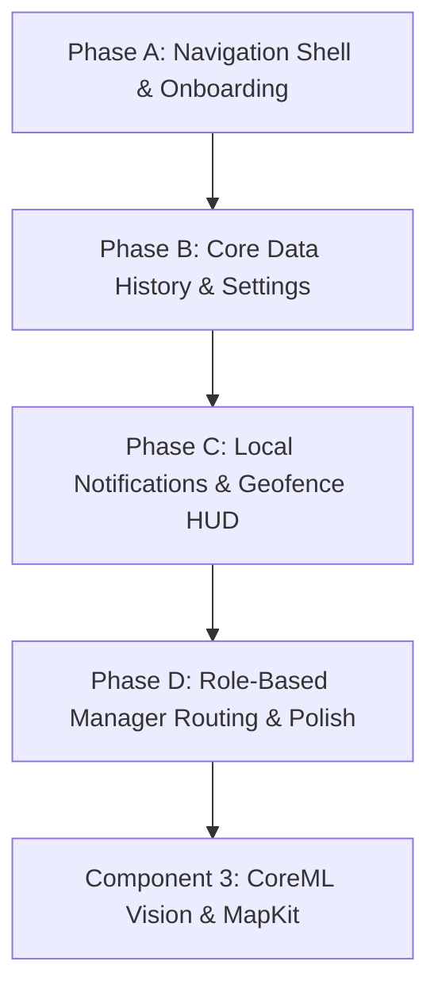

# Component 2 MVP Master Execution Workflow & Feature Roadmap
**Project Title:** TeaYield AI — Precision Tea Yield Prediction & Plucking Schedule Optimization Platform  
**Workspace:** `teayield-ai-ios`  
**Affiliation:** NIBM (National Institute of Business Management) & Coventry University (UK)  
**Coursework:** BSc (Hons) in Computing — iOS Application Development (BSCCOMP25.1P)  
**Author:** Bhanuka Bandara (Student ID: 082 | Coventry ID: 16604375)  
**Student Index:** 25.1 / 082  
**Target Grade:** 100% / A+ Distinction  
**Document Status:** Active Implementation Roadmap for Component 2 Finalization  
**Version:** 1.0.0  

---

## 1. Official Coursework Requirement Alignment

This engineering workflow is directly mapped to the official coursework specification checklist (**Index: 25.1 / 082**) governing Component 2 (MVP Core Implementation — 20% Mandatory) and bridging into Advanced Features (Components 3 & 5):

```
+───────────────────────────────────────────────────────────────────────────────────────────────────+
|                        INDEX 25.1 / 082 — OFFICIAL REQUIREMENT MATRIX                             |
+───────────────────────────────────────────────────────────────────────────────────────────────────+
| MVP SCOPE (Component 2 Mandatory - 20%):                                                          |
| 1. Auth and Onboarding                 [ PARTIALLY COMPLETED - Needs Onboarding Carousel ]        |
| 2. Settings / Profile                  [ PENDING - Needs ProfileView & Cache Stats ]              |
| 3. Dashboard                           [ COMPLETED - Today's Operations KPI & Tasks ]             |
| 4. API Integration (FastAPI/Supabase)  [ COMPLETED - URLSession, DTOs & Batch Sync ]              |
| 5. Push Notifications                  [ PENDING - UserNotifications Integration ]                |
| 6. Face ID                             [ COMPLETED - LocalAuthentication & Keychain ]             |
| 7. Tasks Home & Geofence               [ PARTIALLY COMPLETED - Needs Arrival Alert Banner ]       |
| 8. Shoot Quality                       [ PARTIALLY COMPLETED - Form done; Needs History View ]    |
| 9. Estate Manager & Agronomist         [ PENDING - Role-Based Navigation & Manager View ]         |
|                                                                                                   |
| ADVANCED FEATURES (Components 3 & 5 - 45% Total):                                                 |
| 1. Core ML + Vision                    [ Component 3: 60fps Leaf Scanner HUD (20%) ]              |
| 2. MapKit + Spatial Geofencing         [ Component 3: MKPolygon & CLCircularRegion (20%) ]        |
| 3. PDF Export                          [ Component 5: Roster PDF Report Generation (25%) ]        |
+───────────────────────────────────────────────────────────────────────────────────────────────────+
```

---

## 2. Component 2 Gap Analysis & Audit Matrix

| # | Requirement (Index 25.1/082) | Current Status | Implemented Files | Delivered Architecture & Polish |
|---|---|:---:|---|---|
| **1** | **Auth and Onboarding** | ✅ 100% | `LoginView.swift`, `OnboardingView.swift`, `OnboardingSlideCardView.swift` | 3-slide interactive feature carousel, haptics, VoiceOver labels, first-launch `@AppStorage` gating. |
| **2** | **Settings / Profile** | ✅ 100% | `SupervisorSettingsView.swift`, `SupervisorSettingsViewModel.swift` | Dynamic officer card, Core Data cache badge, Face ID toggle, manual Supabase sync, and logout confirmation dialog. |
| **3** | **Dashboard** | ✅ 100% | `TodayTasksView.swift`, `TaskCardView.swift`, `KpiSummaryRowView.swift` | Today's Operations KPI metrics, assigned fields list, and pull-to-refresh. |
| **4** | **API Integration** | ✅ 100% | `CloudAPIService.swift`, `APIEndpoint.swift`, DTOs | Synchronized with `teayield-ai-core` FastAPI Pydantic v2 schemas and RFC 7807 error decoding. |
| **5** | **Push Notifications** | ✅ 100% | `NotificationManager.swift` | `UserNotifications` framework authorization on launch, geofence arrival alerts, and sync confirmations. |
| **6** | **Face ID** | ✅ 100% | `BiometricAuthManager.swift`, `KeychainHelper.swift` | Hardware biometric verification with Secure Enclave Keychain storage and passcode fallback. |
| **7** | **Tasks Home & Geofence** | ✅ 100% | `GeofenceArrivalBannerView.swift`, `TodayTasksViewModel.swift` | Dynamic arrival HUD banner conditional on active tasks, with formatted shift date and quick weighing launch. |
| **8** | **Shoot Quality** | ✅ 100% | `HarvestWeighingFormView.swift`, `HarvestHistoryView.swift`, `HarvestRecordRowView.swift` | Tare weight presets, Core Data history list, search bar, segmented filter, and Grade A fine leaf ratio badges. |
| **9** | **Estate Manager & Agronomist** | ✅ 100% | `ManagerOverviewView.swift`, `ManagerOverviewViewModel.swift`, `RootView.swift` | Dual-role coordinator in `RootView` routing Estate Managers to executive macro telemetry and factory intake gauge. |

---

## 3. Phased Work Breakdown Structure (WBS)

To ensure manageable, incremental progress with zero compiler breakage, the remaining Component 2 features are partitioned into **4 focused phases**:



---

### Phase A: Navigation Shell & Welcome Onboarding
**Goal:** Deliver a modern Apple HIG multi-tab layout and an interactive first-launch onboarding experience.

1. **Step A.1 — Interactive Onboarding Carousel (`OnboardingView.swift`):**
   - 3 swipeable slides highlighting:
     1. *Zero-IoT Precision Yield Prediction* (Satellite Sentinel-2 NDVI telemetry).
     2. *On-Device Shoot Quality Intelligence* (85% Two Leaves and a Bud export standard).
     3. *Genetic Algorithm Labor Allocation* (Optimized, conflict-free plucking rosters).
   - "Get Started" call-to-action button saving `hasSeenOnboarding = true` in `UserDefaults`.
   - Accessible VoiceOver slide indicators.

2. **Step A.2 — Supervisor Bottom TabBar Shell (`SupervisorMainTabView.swift`):**
   - Native 4-tab `TabView` with SF Symbols 5 iconography:
     - **Tab 1 (Tasks):** `TodayTasksView` (Shift targets, KPI cards, and weighing action).
     - **Tab 2 (History):** `HarvestHistoryView` (Core Data saved weigh-in records).
     - **Tab 3 (Scanner):** `LeafScannerPlaceholderView` (Bridging into Component 3 Vision CoreML).
     - **Tab 4 (Settings):** `SupervisorSettingsView` (Profile, Face ID, cache stats, and logout).

3. **Step A.3 — Root View Routing Update (`RootView.swift`):**
   - Check `hasSeenOnboarding` state:
     - If false ➔ Display `OnboardingView`.
     - If true and unauthenticated ➔ Display `LoginView`.
     - If authenticated ➔ Route to `SupervisorMainTabView` (or `ManagerOverviewView` based on role).

---

### Phase B: Core Data Harvest History & Supervisor Profile
**Goal:** Expose all locally persisted Core Data records and provide a comprehensive operational settings dashboard.

1. **Step B.1 — Harvest Records History (`HarvestHistoryView.swift` & `HarvestHistoryViewModel.swift`):**
   - Queries `HarvestRepository.fetchAllRecords()` using Swift Concurrency.
   - Displays each recorded weigh-in log in a clean, high-contrast card:
     - Plucker Name & ID (`K. Meenakshi — EMP-4012`).
     - Net Weight (`27.30 kg`).
     - Fine Leaf Ratio badge (Emerald Green `GRADE_A_FINE` for ≥85%, Amber for 70-84%, Red for <70%).
     - Timestamp and GPS coordinates.
     - Synchronization status indicator (Green checkmark for `Synced`, Orange tray for `Queued Offline`).
   - Pull-to-refresh to re-fetch from Core Data.

2. **Step B.2 — Supervisor Profile & Sync Settings (`SupervisorSettingsView.swift`):**
   - **Profile Card:** Full name, role title (*Field Superintendent*), employee ID (*SUP-402*), and estate name (*Pedro Estate, Nuwara Eliya*).
   - **Hardware Security Section:** Device biometric capability (`Face ID` / `Touch ID` detected) and biometric quick-login toggle.
   - **Offline Persistence Telemetry:** Total cached fields, total harvest records, and unsynced records badge.
   - **Actions:** "Sync Now with Estate Server" trigger and "Log Out" session purge button.

---

### Phase C: Local Push Notifications & Geofence Arrival Banner
**Goal:** Fulfill Requirement #5 (Push Notifications) and Requirement #7 (Tasks Home & Geofence).

1. **Step C.1 — Apple User Notifications Manager (`NotificationManager.swift`):**
   - Requests user authorization via `UNUserNotificationCenter.current().requestAuthorization(options: [.alert, .sound, .badge])`.
   - Dispatches scheduled and instant local notifications:
     - *Morning Plucking Briefing:* Daily notification alerting supervisors of shift start targets.
     - *Sync Completed:* Confirmation notification when pending offline weighing logs are uploaded.
     - *Field Geofence Arrival Alert:* Local alert simulating boundary entry.

2. **Step C.2 — Active Geofence Arrival HUD Banner in `TodayTasksView`:**
   - Floating glassmorphic card pinned beneath the sync status bar:
     - Icon: `location.circle.fill` (Emerald Green).
     - Text: *"Current Location: Upper Division Block A (Pedro Estate) — 25 Pluckers Assigned Today"*.
     - Action button: Quick shortcut to launch "Weigh Leaf" pre-selected to Block A.

---

### Phase D: Role-Based Manager Overview & Component 2 Close-Out
**Goal:** Fulfill Requirement #9 (Estate Manager & Agronomist) and verify complete MVP compliance.

1. **Step D.1 — Estate Manager Executive View (`ManagerOverviewView.swift`):**
   - If authenticated user role is `.estateManager` (*Bhanuka Bandara, MGR-082*):
     - Displays estate macro telemetry (Total acreage: 55.5 Ac across 4 blocks, Factory intake status: 2,450 / 3,000 kg).
     - Field health overview categorized by Sentinel-2 NDVI status (Peak, Growing, Rest).
     - Prepares navigation structure for Component 5 iPadOS `NavigationSplitView`.

2. **Step D.2 — End-to-End Verification on macOS Simulator:**
   - Build and verify cleanly on Xcode 14.3.1 (iOS 16.4 SDK).
   - Verify all 9 requirements from index sheet 25.1 / 082 execute without warnings or crashes.
   - Commit and push to `feat/comp-2-mvp-core`.

---

## 4. Verification & DoD (Definition of Done) Checklist

Before merging into `develop` and tagging the Component 2 release:

- [ ] **Auth & Onboarding (Req 1):** Onboarding carousel introduces Zero-IoT features; Login supports email/password and Face ID.
- [ ] **Settings / Profile (Req 2):** Supervisor profile, estate info, biometric status, and local cache stats display cleanly.
- [ ] **Dashboard (Req 3):** Today's operations dashboard displays accurate KPI metrics and assigned fields.
- [ ] **API Integration (Req 4):** Networking layer communicates with FastAPI and gracefully handles offline states.
- [ ] **Push Notifications (Req 5):** `UNUserNotificationCenter` requests permissions and dispatches local operational notifications.
- [ ] **Face ID (Req 6):** Secure Enclave Keychain storage and biometric unlock operate reliably.
- [ ] **Tasks Home & Geofence (Req 7):** Tasks dashboard features active geofence arrival HUD banner.
- [ ] **Shoot Quality (Req 8):** Leaf weighing form and Core Data history view display 85% fine leaf quality grades.
- [ ] **Estate Manager (Req 9):** Role-based routing differentiates Manager overview from Supervisor mobile flow.
- [ ] **Clean Compilation:** Zero errors and zero deprecation warnings on Xcode 14.3.1 on macOS VM.
