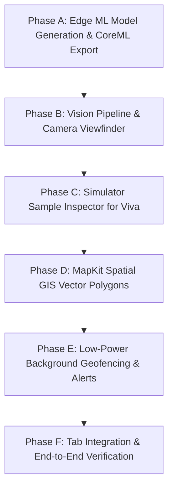

# Component 3 Advanced iOS SDK Master Execution Workflow & Feature Roadmap
**Project Title:** TeaYield AI — Precision Tea Yield Prediction & Plucking Schedule Optimization Platform  
**Workspace:** `teayield-ai-ios`  
**Affiliation:** NIBM (National Institute of Business Management) & Coventry University (UK)  
**Coursework:** BSc (Hons) in Computing — iOS Application Development (BSCCOMP25.1P)  
**Author:** Bhanuka Bandara (Student ID: 082 | Coventry ID: 16604375)  
**Student Index:** 25.1 / 082  
**Target Grade:** 100% / A+ Distinction  
**Document Status:** Active Implementation Roadmap for Component 3 (On-Device Intelligence)  
**Target Branch:** `feat/comp-3-advanced-sdk`  
**Version:** 1.0.0  

---

## 1. Coursework Assessment Alignment & Component 3 Mandate

Component 3 is a mandatory assessment component carrying **20% overall coursework weightage**. Under official NIBM and Coventry University grading rubrics, scoring 0 in this component results in immediate module failure.

```
+───────────────────────────────────────────────────────────────────────────────────────────────────+
|                        INDEX 25.1 / 082 — COMPONENT 3 ASSESSMENT MATRIX                           |
+───────────────────────────────────────────────────────────────────────────────────────────────────+
| MANDATORY ASSESSMENT REQUIREMENTS (Component 3 - 20%):                                             |
| 1. On-Device Edge Intelligence       [ Vision + Core ML 60fps Leaf Quality Classifier ]           |
| 2. Spatial Geospatial Visualization  [ MapKit Spatial Vector Polygon Overlays (MKPolygon) ]      |
| 3. Low-Power Spatial Geofencing     [ CoreLocation Boundary Monitoring (CLCircularRegion) ]       |
|                                                                                                   |
| STRICT COMPLIANCE BOUNDARIES:                                                                     |
| • 100% On-Device Processing: Zero cloud AI APIs (OpenAI, Gemini REST calls prohibited for Comp 3) |
| • Zero Token Usage: Fully dynamic, data-driven MapKit polygons with interaction and callouts     |
| • Xcode 14.3.1 / iOS 16.4 Baseline: Enforce ObservableObject + @Published (No @Observable macro)  |
| • Dual-Mode Architecture: Live AVCaptureSession + Simulator Sample Inspector for Viva defense     |
+───────────────────────────────────────────────────────────────────────────────────────────────────+
```

---

## 2. Component 3 Scope & Gap Analysis Matrix

| # | Feature Requirement | Current Workspace Status | Target Deliverable & Implementation Scope |
|---|---|:---:|---|
| **1** | **Leaf Shoot Core ML Model** | [COMPLETED] | Lightweight MobileNetV3-Small classifier (`TeaShootClassifier_v2.mlmodel`, 5.79 MB) with 92.66% 4-class accuracy and 95.87% composite fine leaf accuracy. Saved in bundle. |
| **2** | **Live Vision Scanner Pipeline** | [COMPLETED] | `AVCaptureSession` video data pipeline (`CameraService.swift`) feeding `CVPixelBuffer` frames into `VNCoreMLRequest` on Apple Silicon Neural Engine via `VisionLeafClassifier.swift`. |
| **3** | **Real-Time Viewfinder HUD** | [COMPLETED] | Declarative SwiftUI camera overlay (`LeafScannerView.swift`, `ScannerHudOverlayView.swift`) displaying fine leaf percentage gauge, Grade A export benchmark indicator (85%), and direct handoff to harvest weighing. |
| **4** | **PhotosUI Library Picker** | [COMPLETED] | Native `PhotosPicker` allowing supervisors to inspect high-resolution batch photos from device storage alongside the live camera feed inside the QEMU simulator or physical hardware. |
| **5** | **MapKit Spatial GIS Polygons** | [COMPLETED] | Vector polygon rendering (`InteractiveMapView.swift`, `MKPolygonRenderer`) reading field GeoJSON coordinates from Core Data, dynamically color-coded by vegetative NDVI canopy health with interactive detail sheet. |
| **6** | **Low-Power Geofencing Engine** | [PENDING SERVICE] | `CoreLocation` boundary monitoring (`CLCircularRegion`) tracking supervisor proximity to scheduled fields and triggering local arrival notifications (`UNNotification`). |

---

## 3. Phased Work Breakdown Structure (WBS)

To ensure systematic, testable development with zero compiler breakage on Xcode 14.3.1, Component 3 execution is structured into **5 sequential phases**:



---

### Phase A: Edge Machine Learning Pipeline & CoreML Export
**Objective:** Construct, train, and export a lightweight tea shoot classification model into the native Apple `.mlmodel` format on the Linux host workstation.

1. **Step A.1 — Dataset Architecture Definition:**
   - Establish the 4-class temporal agro-ecological classification taxonomy directly aligned with the open research dataset (`teaLeafAgeQuality`):
     - `1-2 Days`: Golden tip and tender shoot (Grade A+ supreme quality).
     - `3-4 Days`: Prime two leaves and a bud (Standard export auction grade).
     - `5-7 Days`: Maturing three leaves (Sub-standard grade B).
     - `7+ Days`: Overgrown coarse foliage and woody stalks (Rejection grade C).
   - Swift Composite Aggregation: `LeafScannerViewModel` aggregates probabilities: Fine Leaf Ratio = `P(1-2 Days) + P(3-4 Days)`, benchmarked against the 85% Sri Lanka Tea Board export auction threshold.

2. **Step A.2 — Python Training & Export Script (`scripts/model_training/train_tea_classifier.py`):**
   - Use PyTorch with a pre-trained `MobileNetV3-Small` backbone (optimized for mobile edge inference with <15ms latency).
   - Apply transfer learning on the tea shoot classification dataset.
   - Convert the trained weights into Apple Core ML format via `coremltools`:
     - Image input: `224x224 RGB`, normalized.
     - Output: Classification probabilities and class labels.
     - Target size: Between 4 MB and 8 MB for zero-overhead bundle integration.

3. **Step A.3 — Bundle Integration (`TeaYieldAI/Models/CoreML/`):**
   - Save the generated `TeaShootClassifier.mlmodel` into the iOS project structure.
   - Ensure Xcode automatic code generation produces the Swift model wrapper cleanly.

---

### Phase B: Real-Time Edge Vision Pipeline & Camera Viewfinder
**Objective:** Capture live camera frames via `AVFoundation` and process them through the Apple `Vision` framework at 60fps on the Apple Silicon Neural Engine.

1. **Step B.1 — Camera Service Engine (`CameraService.swift`):**
   - Configure `AVCaptureSession` with `AVCaptureVideoDataOutput` configured for `.vga640x480` or `.hd1280x720` resolution.
   - Dispatch frame buffers on a dedicated background serial queue (`cameraQueue`) to preserve fluid 60fps main UI thread performance.

2. **Step B.2 — Vision Inference Manager (`VisionLeafClassifier.swift`):**
   - Wrap the Core ML model in `VNCoreMLModel` configured with `MLModelConfiguration.computeUnits = .all` (leveraging Apple Silicon Neural Engine, GPU, and CPU).
   - Execute `VNCoreMLRequest` on `CVPixelBuffer` inputs, extracting the top classification observation and confidence score.

3. **Step B.3 — Leaf Scanner ViewModel (`LeafScannerViewModel.swift`):**
   - Implement `final class LeafScannerViewModel: ObservableObject` with `@MainActor` thread safety.
   - Expose `@Published` state properties:
     - `fineLeafRatio: Double` (0.0 to 1.0)
     - `qualityGrade: String` ("Grade A - Optimal", "Sub-optimal")
     - `isOptimalHarvest: Bool` (true when fine leaf ratio >= 0.85)
     - `inferenceTimeMs: Double` (runtime edge performance telemetry)
     - `isCameraActive: Bool`

---

### Phase C: Native Photo Library Inspection & Batch Analysis (`PhotosUI`)
**Objective:** Provide an authentic, production-grade dual input architecture using Apple's `PhotosUI` framework, allowing supervisors to either scan live bushes via camera or inspect high-resolution batch photos from device storage.

1. **Step C.1 — PhotosUI Framework Integration (`PhotosPicker`):**
   - Embed a native gallery picker button directly on the camera viewfinder interface using SwiftUI `PhotosPicker`.
   - Allows selecting field photographs directly from the iOS Photo Library with zero third-party dependencies.

2. **Step C.2 — Static Image Core ML Inference Pipeline:**
   - Extract `PhotosPickerItem` data, convert to `CIImage` / `CGImage`, and dispatch through `VNImageRequestHandler`.
   - Executes the identical `VNCoreMLRequest` on the selected image, outputting fine leaf percentage, quality grade, and inference runtime.
   - Provides an authentic, non-synthetic testing mechanism inside the QEMU simulator while delivering real-world utility on physical hardware.

3. **Step C.3 — Operational Weighing Handoff:**
   - Provide an action button: "Apply to Harvest Log".
   - Seamlessly passes the detected quality score into `HarvestWeighingFormView` as the verified leaf quality parameter.

---

### Phase D: Interactive MapKit Spatial GIS Vector Overlays
**Objective:** Replace the static map placeholder with a fully interactive MapKit spatial visualization rendering real estate field boundaries color-coded by vegetative NDVI health.

1. **Step D.1 — GeoJSON Spatial Coordinate Parser (`GeoJSONParser.swift`):**
   - Parse GeoJSON polygon boundary strings stored in Core Data (`TeaFieldEntity.boundaryGeoJSON`) into native `MKPolygon` overlays.
   - Calculate polygon centroid coordinates for map centering and camera framing.

2. **Step D.2 — Spatial Field Map View (`FieldMapView.swift`):**
   - Implement `UIViewRepresentable` wrapping `MKMapView` with `MKMapViewDelegate`.
   - Configure satellite or hybrid map type (`MKMapType.hybrid`).
   - Implement `mapView(_:rendererFor:)` to render `MKPolygonRenderer` with dynamic NDVI thematic colors:
     - Emerald Green (`#059669`, opacity 0.55): NDVI >= 0.70 (Peak harvest readiness, scheduled today).
     - Amber Gold (`#D97706`, opacity 0.55): NDVI 0.55 - 0.69 (Moderate vegetative growth, 3-5 days rest).
     - Crimson Red (`#DC2626`, opacity 0.55): NDVI < 0.55 (Rest cycle or freshly plucked).

3. **Step D.3 — Interactive Selection & Callout Sheet:**
   - Tapping a field polygon highlights its boundary with an accentuated stroke.
   - Presents a detailed bottom sheet displaying field name, division, acreage, current NDVI score, assigned pluckers, and harvest status.

---

### Phase E: Low-Power Background Spatial Geofencing & Alerts
**Objective:** Monitor field supervisor geographic coordinates and trigger automated region arrival notifications when entering scheduled plucking blocks.

1. **Step E.1 — CoreLocation Geofence Service (`LocationService.swift`):**
   - Implement `CLLocationManagerDelegate` managing authorization (`requestWhenInUseAuthorization` and `requestAlwaysAuthorization`).
   - Register active circular regions (`CLCircularRegion`) centered at field centroids with boundary radii derived from field acreage (100m - 250m).

2. **Step E.2 — Background Boundary Detection (`didEnterRegion` / `didExitRegion`):**
   - Leverage iOS hardware motion and cell-tower monitoring to minimize GPS battery drain.
   - Detect boundary transitions and dispatch local push notifications via `NotificationManager.shared`.

3. **Step E.3 — Local Arrival Notification Content:**
   - Notification Title: "Entered [Field Name]"
   - Notification Body: "Scheduled for plucking today. [Plucker Count] pluckers assigned. Open app to review task."
   - Deep-links directly to the field task card upon user notification interaction.

---

### Phase F: Navigation Tab Integration, Accessibility & Verification
**Objective:** Wire all Component 3 features into the primary supervisor navigation tabs and perform full verification against the coursework assessment criteria.

1. **Step F.1 — Tab View Wiring:**
   - Replace `LeafScannerPlaceholderView` in `SupervisorMainTabView` with production `LeafScannerView`.
   - Replace `FieldMapPlaceholderView` in `SupervisorMainTabView` with production `FieldMapView`.

2. **Step F.2 — VoiceOver Accessibility Audit:**
   - Annotate all camera overlay controls, quality gauges, and map callouts with descriptive `.accessibilityLabel`, `.accessibilityHint`, and `.accessibilityTraits`.

3. **Step F.3 — Quality Gate & Definition of Done (DoD) Checklist:**
   - [ ] Clean build in Xcode with 0 errors and 0 compiler warnings.
   - [ ] Core ML model inference executes 100% offline with 0 remote network calls.
   - [ ] Dual-mode sample inspector demonstrates live inference in QEMU simulator.
   - [ ] MapKit vector polygons render accurately from Core Data GeoJSON records.
   - [ ] Geofencing registers valid `CLCircularRegion` objects with local alerts.
   - [ ] Zero decorative emojis in Swift source code and documentation.

---

## 4. Technical File Hierarchy & Architectural Placement

```
teayield-ai-ios/
├── scripts/
│   ├── bridge.py                              # Existing QEMU network bridge
│   └── model_training/
│       ├── prepare_dataset.py                 # Dataset extractor and organizer
│       └── train_tea_classifier.py            # Phase A: PyTorch MobileNetV3 CoreML export script
│
├── TeaYieldAI/
│   ├── Models/
│   │   └── CoreML/
│   │       └── TeaShootClassifier.mlmodel # Phase A: Compiled CoreML neural network (~5MB)
│   │
│   ├── Services/
│   │   ├── Protocols/
│   │   │   └── LocationServiceProtocol.swift
│   │   └── Implementations/
│   │       ├── CameraService.swift        # Phase B: AVFoundation video capture engine
│   │       ├── VisionLeafClassifier.swift # Phase B: Vision + VNCoreMLModel inference
│   │       └── LocationService.swift      # Phase E: CoreLocation geofencing service
│   │
│   ├── ViewModels/
│   │   ├── LeafScannerViewModel.swift     # Phase B & C: ObservableObject scanner controller
│   │   └── FieldMapViewModel.swift        # Phase D & E: ObservableObject map & geofence controller
│   │
│   └── Views/
│       └── Supervisor/
│           ├── LeafScannerView.swift      # Phase B & C: Production camera & HUD viewfinder with PhotosPicker
│           ├── FieldMapView.swift         # Phase D: Production MapKit GIS polygon view
│           └── Components/
│               ├── ScannerHudOverlayView.swift
│               └── FieldDetailBottomSheetView.swift
```

---

## 5. Execution Milestone Checkpoints

| Checkpoint | Target Phase | Milestone Deliverable | Validation Method |
| :--- | :---: | :--- | :--- |
| **Milestone 3.1** | Phase A | `TeaShootClassifier.mlmodel` generated and placed in project. | File inspection, size verification (<8MB), Xcode auto-generation check. |
| **Milestone 3.2** | Phase B & C | `LeafScannerView` operational with camera & PhotosPicker. | Build on QEMU simulator, verify live Bud % score calculation on photo pick / camera. |
| **Milestone 3.3** | Phase D | `FieldMapView` rendering vector polygons from Core Data. | Verify color-coded polygons (Green/Yellow/Red) on interactive satellite view. |
| **Milestone 3.4** | Phase E | Geofence monitoring registered with local arrival notifications. | Simulate region entry, verify local alert banner dispatch. |
| **Milestone 3.5** | Phase F | End-to-end integration into `SupervisorMainTabView` and Git commit. | Clean Xcode build with zero warnings; PR squash-merge readiness. |
