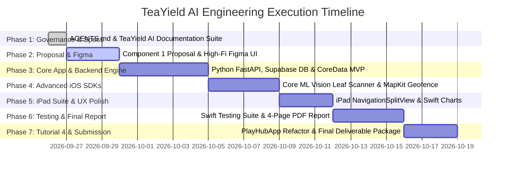

# Master Engineering Workflow & Delivery Roadmap
**Project Title:** TeaYield AI — Precision Tea Yield Prediction & Plucking Schedule Optimization Platform  
**Coursework:** NIBM BSC (Hons) Computing — iOS Application Development (BSCCOMP25.1P)  
**Target Grade:** 100% / A+ Distinction  
**Author:** Bhanuka Bandara (Student ID: 082)  

---

## 📅 Multi-Phase Execution Timeline & Roadmap

---

## 📑 Phase Breakdown & Definition of Done (DoD)

### Phase 1: Governance & Technical Specifications (100% Complete)
- [x] Create `.agents/AGENTS.md` (Industry-standard rules and academic integrity safeguards).
- [x] Create `docs/teayield_ai_specs/` suite (All 8 dedicated TeaYield AI specifications).
- [x] Create `WORKFLOW.md` (Master timeline and definition of done).

### Phase 2: Component 1 — Proposal & Figma UI/UX Prototype (10% - Mandatory)
- [ ] Finalize TeaYield AI problem statement, target profiles (Managers vs Supervisors), and Zero-IoT USP.
- [ ] Design High-Fidelity Figma Prototype (iOS HIG compliant, dark/light mode, iPhone mobile flow, iPad executive suite flow).
- [ ] Submit Component 1 proposal document & Figma prototype via LMS for lecturer approval.

### Phase 3: Component 2 — Core App MVP, Backend Engine & Security (20% - Mandatory)
- [ ] Deploy **Supabase (PostgreSQL + PostGIS)** cloud database for spatial field polygon storage.
- [ ] Build **Python FastAPI** cloud service hosting PyTorch LSTM yield forecasting model and DEAP Genetic Algorithm scheduler.
- [ ] Setup Xcode Project with MVVM folder structure (`Models`, `Views`, `ViewModels`, `Services`, `Repositories`).
- [ ] Implement **Core Data** local entities schema (`TeaFieldEntity`, `NDVILogEntity`, `PluckingSessionEntity`).
- [ ] Implement **Face ID / Touch ID** biometric security via `LocalAuthentication` for financial roster access.
- [ ] Prepare live Viva presentation defense notes.

### Phase 4: Component 3 — Advanced iOS SDK Integration (On-Device) (20% - Mandatory)
- [ ] Integrate **On-Device Core ML + Vision Framework** (`VNCoreMLModel`) 60fps real-time camera leaf maturity scanner (Bud & 2-Leaves ratio).
- [ ] Implement **MapKit** spatial vector field polygon overlays (`MKPolygon`) and active **`CLCircularRegion` background geofence alerts**.
- [ ] Verify 0 remote cloud AI API dependencies and confirm no recycling of Component 2 features.

### Phase 5: Component 5 — Above & Beyond, iPad Executive Suite & Polish (25% - Maximum Weightage)
- [ ] Implement responsive multi-device design: **iPhone compact supervisor view** and **iPad desktop-class `NavigationSplitView` manager suite**.
- [ ] Integrate Apple **Charts Framework** (`BarMark`, `LineMark`) for predicted yield visualizations.
- [ ] Refactor application services using Protocol-Oriented Programming (POP) and Dependency Injection (`AppContainer`).
- [ ] Add SwiftUI custom matched geometry animations, micro-haptics (`UIImpactFeedbackGenerator`), and offline status banners.

### Phase 6: Component 4 — Swift Testing, Accessibility & Final Report (15%)
- [ ] Write unit test suite using Apple's modern **Swift Testing framework** (`import Testing`, `@Test`, `#expect`).
- [ ] Add 100% VoiceOver accessibility labels, hints, traits, and Dynamic Type text scaling.
- [ ] Compile 4-Page Final Report PDF including **Learning Outcomes (LO1–LO4) Reflection matrix** & mandatory LLM log.

### Phase 7: Component 6 & Final Deliverables Package (10%)
- [ ] Refactor Tutorial 1-3 game modes into **PlayHubApp** (Component 6 - 10%).
- [ ] Record narrated screen recording video explaining TeaYield AI features.
- [ ] Tag final Git commit, push to private repository, and assemble final submission `.zip` package.

---

## 🛠️ Conventional Git Commit Standards

All commits must strictly follow Conventional Commits standard for clean assessment evaluation:
- `feat(comp1): finalize TeaYield AI proposal and Figma UI links`
- `feat(comp2): deploy Supabase PostGIS DB and Python FastAPI REST endpoints`
- `feat(comp2): implement Core Data persistence and Face ID auth`
- `feat(comp3): integrate Core ML Vision leaf shoot scanner`
- `feat(comp3): add MapKit field polygon overlays and background geofencing`
- `feat(comp5): implement iPad NavigationSplitView and Swift Charts yield graphs`
- `test(comp4): add Swift Testing unit test suite for ViewModels`
- `docs(comp4): complete 4-page report LO reflection matrix`
