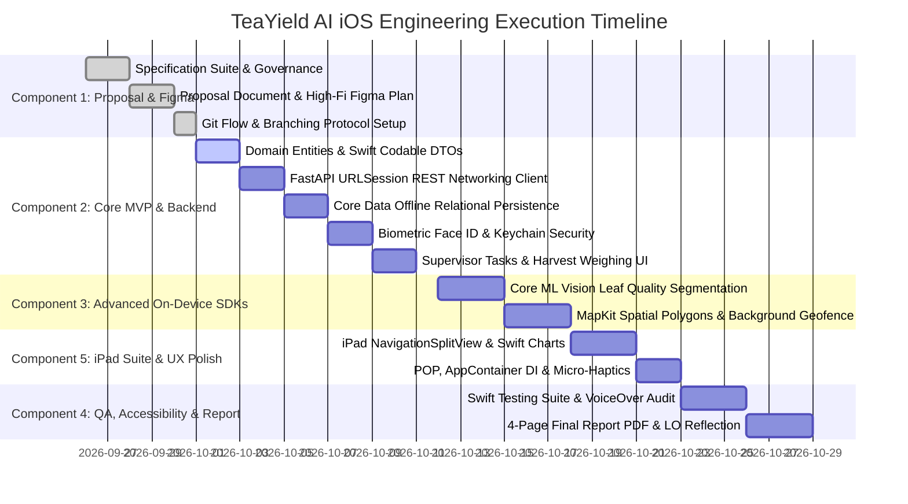

# Master Engineering Workflow & Delivery Roadmap
**Project Title:** TeaYield AI — Precision Tea Yield Prediction & Plucking Schedule Optimization Platform (iOS Companion Client)  
**Workspace:** `teayield-ai-ios`  
**Affiliation:** Coventry University (UK) & National Institute of Business Management (Sri Lanka)  
**Coursework:** BSc (Hons) in Computing — iOS Application Development (BSCCOMP25.1P)  
**Author:** Bhanuka Bandara (Student ID: 082 | Coventry ID: 16604375)  
**Target Grade:** 100% / A+ Distinction  
**Companion Core Repository:** `~/BSC-computing/research/teayield-ai-core` (Backend Core)  
**Document Status:** Active Master Engineering Roadmap  
**Version:** 1.1.0  

---

## 1. Dual-Track Ecosystem Execution Status

The TeaYield AI platform operates on an Agile API-First dual-track strategy. The backend core (`teayield-ai-core`) has completed its database provisioning and API contract deployment, unblocking the native iOS companion application (`teayield-ai-ios`):

```
+───────────────────────────────────────────────────────────────────────────────────────────────────+
|                                    ECOSYSTEM WORKFLOW STATUS                                      |
+───────────────────────────────────────────────────────────────────────────────────────────────────+
| teayield-ai-core (Backend & Research):                                                            |
| • Phase 1: Specifications & Governance (Specs 01-08)                 [ COMPLETED ]                 |
| • Phase 2: Supabase PostgreSQL 15 & PostGIS Spatial Layer            [ COMPLETED ]                 |
| • Phase 3: FastAPI REST Service & Deterministic Stubs (31 tests pass) [ COMPLETED ]                 |
|                                                                                                   |
| teayield-ai-ios (Client & iOS Coursework):                                                        |
| • Component 1: Proposal, HIG Design System & Figma Prototype (10%)    [ COMPLETED ]                 |
| • Component 2: MVP Core Implementation, Offline & Viva (20%)          [ COMPLETED ]                 |
| • Component 3: Advanced iOS SDK - On-Device Vision & Geofence (20%)   [ COMPLETED ]                 |
| • Component 4: Swift Testing, VoiceOver & 4-Page Report (15%)         [ IN PROGRESS ]               |
| • Component 5: Above & Beyond - iPad SplitView & Architecture (25%)   [ PENDING ]                   |
+───────────────────────────────────────────────────────────────────────────────────────────────────+
```

---

## 2. Multi-Phase Execution Timeline & Roadmap



---

## 3. Work Breakdown Structure (WBS) & Detailed Technical Specifications

---

### Component 1: Proposal, HIG Design System & High-Fidelity UI/UX Prototype [ COMPLETED ]
- **Status:** [ COMPLETED ]
- **Target Weightage:** 10% (Mandatory Component)
- **Objective:** Formulate the agritech domain problem statement, Zero-IoT architecture, Apple HIG design system tokens, 10-screen interactive Figma prototype, and project proposal submission.
- **Detailed Sub-Steps:**
  - **1.1 [ COMPLETED ] Problem Statement & Domain Definition:** Formulate the operational crisis of manual heuristics, plucker misallocation, and factory withering bottlenecks across Nuwara Eliya estates in `docs/teayield_ai_specs/01_App_Proposal_Figma.md`.
  - **1.2 [ COMPLETED ] Apple HIG Design System Formulation:** Define semantic light/dark mode color tokens (`Primary Emerald`, `Secondary Amber`, `Rest Crimson`), SF Pro typography scale, card radii, and materials in `docs/project_documents/DESIGN.md`.
  - **1.3 [ COMPLETED ] 10-Screen Figma Prototype Specification:** Formulate master component library architecture, responsive size-class adaptations, and prompt specifications for Figma AI in `docs/project_documents/teayield_ai_figma_prototype_plan.md`.
  - **1.4 [ COMPLETED ] Formal Proposal Document Compilation:** Compile academic coursework proposal submission covering background, target profiles, and technical stack justifications in `docs/project_documents/teayield_ai_proposal_submission.md`.
  - **1.5 [ COMPLETED ] Master Git Flow & Branching Protocol:** Formulate the enterprise Git Flow branching model, Conventional Commits 1.0.0, PR quality gate, and dual-repo version sync in `docs/teayield_ai_specs/GIT_BRANCHING_STRATEGY.md`.
- **Deliverables:**
  - Approved App Proposal Document.
  - 10-Screen Interactive Figma Prototype Link.
  - Complete Specification Suite (01 through 09).
  - Production-grade `.gitignore` and `.github/pull_request_template.md`.
- **Definition of Done (DoD):** Proposal finalized with zero emojis; Figma share link validated; git repositories synchronized on `main` and `develop`.

---

### Component 2: MVP Core Implementation, External API & Live Viva [ COMPLETED ]
- **Status:** [ COMPLETED ]
- **Target Weightage:** 20% (Mandatory Component)
- **Target Branch:** `feat/comp-2-mvp-core`
- **Objective:** Construct the foundational native iOS application codebase implementing clean MVVM architecture, FastAPI REST connectivity, Core Data offline persistence, and biometric Face ID security.
- **Detailed Sub-Steps:**
  - **2.1 [ COMPLETED ] MVVM Folder Architecture & Foundation Entities:** Construct the production Swift directory hierarchy (`TeaYieldAI/`: `App/`, `Core/`, `Models/`, `Views/`, `ViewModels/`, `Services/`, `Persistence/`) with immutable domain structs (`TeaField`, `PluckingTask`, `HarvestRecord`, `UserProfile`), dynamic `AppConfiguration`, and isolated `MockData` fixtures.
  - **2.2 [ COMPLETED ] Swift Codable DTO Contracts:** Implement Codable request/response DTOs strictly synchronized with `teayield-ai-core` Pydantic v2 schemas (`AuthDTOs`, `FieldDTOs`, `TaskDTOs`, `HarvestSyncDTOs`, `EstateDTOs`, `APIErrorDTO`).
  - **2.3 [ COMPLETED ] Asynchronous URLSession Networking Layer (`CloudAPIService`):** Implement `APIServiceProtocol`, `APIEndpoint` builder, `NetworkError`, and concrete `CloudAPIService` managing async/await requests, Bearer token injection, and RFC 7807 problem details error decoding.
  - **2.4 [ COMPLETED ] Core Data Relational Schema & Offline Persistence Stack:** Define Core Data managed object model (`TeaFieldEntity`, `NDVILogEntity`, `HarvestLogEntity` / `PluckingSessionEntity`) with `NSPersistentContainer` background context execution (`newBackgroundContext()`), in-memory preview support, and thread-safe repositories (`FieldRepository`, `HarvestRepository`, `NDVIRepository`).
  - **2.5 [ COMPLETED ] Store-and-Forward Offline Sync Engine:** Implement `OfflineSyncManager` and `NetworkMonitor` utilizing `NWPathMonitor` to detect network recovery, batch unsynced weighing records (`isSynced = false`), dispatch to `POST /api/v1/harvest/sync`, and reconcile server `synced_ids`.
  - **2.6 [ COMPLETED ] Biometric Estate Security (`LocalAuthentication` Face ID):** Implement `AuthService`, `KeychainHelper`, and `BiometricAuthManager` managing Face ID / Touch ID hardware authentication with passcode fallback and Secure Enclave Keychain token storage.
  - **2.7 [ COMPLETED ] Supervisor Operational Views & ViewModels:** Build declarative SwiftUI views (`TodayTasksView`, `HarvestWeighingFormView`, `LoginView`) driven by `@MainActor` ViewModels (`TodayTasksViewModel`, `HarvestWeighingViewModel`, `AuthViewModel`).
  - **2.8 [ COMPLETED ] Live Viva Defense Notes & Verification:** Prepare code ownership defense answers and verify live challenge modifications in `docs/teayield_ai_specs/07_Viva_Preparation_Guide.md`.
- **Deliverables:**
  - Complete Swift source code for Component 2 compiling cleanly in Xcode.
  - Working `URLSession` REST networking communicating with FastAPI stubs.
  - Core Data offline persistence with idempotent UUID synchronization.
  - Face ID biometric authentication gate.
- **Definition of Done (DoD):** Clean Xcode build; zero runtime data race warnings; offline weighing records successfully cache and sync; passes live viva defense.

---

### Component 3: Advanced iOS SDK Integration — On-Device Intelligence [ READY TO EXECUTE ]
- **Status:** [ READY TO EXECUTE ]
- **Target Weightage:** 20% (Mandatory Component)
- **Target Branch:** `feat/comp-3-advanced-sdk`
- **Objective:** Deploy 100% offline edge computing on the Apple Silicon Neural Engine for tea shoot maturity scanning alongside MapKit spatial GIS polygon overlays and background geofencing.
- **Detailed Sub-Steps:**
  - **3.1 [ PENDING ] Camera Frame Capture Pipeline (`AVFoundation`):** Configure `AVCaptureSession` and `AVCaptureVideoDataOutput` with background queue dispatch and `CVPixelBuffer` pool management preserving 60fps UI responsiveness.
  - **3.2 [ PENDING ] On-Device Core ML Leaf Quality Classifier (`Vision` + `CoreML`):** Integrate `VNCoreMLModel` executing fine vs coarse leaf shoot segmentation (*"Two Leaves and a Bud"*) 100% on-device with zero cloud AI API dependencies.
  - **3.3 [ PENDING ] MapKit Spatial GIS Vector Polygons (`MKPolygon`):** Render estate field boundaries as interactive vector polygon overlays color-coded by vegetative NDVI health (Emerald `#059669`, Amber `#D97706`, Crimson `#DC2626`).
  - **3.4 [ PENDING ] Low-Power Background Geofencing Engine (`CLCircularRegion`):** Implement `CoreLocation` boundary monitoring alerting supervisors via local push notifications upon entering harvest-ready fields without battery drain.
- **Deliverables:**
  - 60fps real-time camera viewfinder shoot quality analyzer.
  - Dynamic MapKit estate field visualization with custom callouts.
  - Background geofencing arrival notification engine.
- **Definition of Done (DoD):** Camera viewfinder segmentation executes 100% offline without network; background geofence triggers local alerts upon entering coordinates; strictly zero remote AI calls.

---

### Component 4: Swift Testing, Accessibility & Formal Documentation [ PENDING ]
- **Status:** [ PENDING ]
- **Target Weightage:** 15% (Elective / Max Marks)
- **Target Branch:** `feat/comp-4-qa-a11y-report`
- **Objective:** Validate application reliability with modern Apple Swift Testing suites, achieve 100% VoiceOver accessibility compliance, and compile the 4-page academic final report PDF.
- **Detailed Sub-Steps:**
  - **4.1 [ COMPLETED ] Apple Swift Testing Suite Implementation (`import Testing`):** Construct macro-driven test suites (`@Suite`, `@Test`, `#expect`) with dual XCTest compatibility fallback covering ViewModel state logic, DTO mapping, and offline Core Data persistence fallbacks across 19 test files and 10 mock doubles.
  - **4.2 [ COMPLETED ] VoiceOver 100% Accessibility Compliance Audit:** Annotate every interactive control, camera overlay, toolbar button, and settings toggle with descriptive `.accessibilityLabel`, `.accessibilityHint`, and `.accessibilityTraits`.
  - **4.3 [ COMPLETED ] Dynamic Type Semantic Font Scaling Audit:** Wrap container views in flexible `ScrollView` and dynamic layouts, verifying zero text clipping when system font scales up to accessibility sizes.
  - **4.4 [ PENDING ] 4-Page Final Report PDF Compilation:** Compile the formal 4-page academic report covering overview, system architecture, technical challenges, and explicit Learning Outcomes Reflection (LO1–LO4) [Postponed until final code lock].
  - **4.5 [ PENDING ] Academic Integrity Declaration & LLM Usage Log:** Formulate the non-code LLM usage log in accordance with university anti-AI humanization standards (`.agents/rules/AGENT_REPORT.md`).
- **Deliverables:**
  - Swift Testing suite passing 100% green with dual Xcode 14.3.1 / 16 compatibility.
  - 100% VoiceOver-compliant user interface across all views.
  - 4-Page Final Report PDF (scheduled after Component 5).
- **Definition of Done (DoD):** All unit tests pass; zero unlabelled elements in VoiceOver; report adheres strictly to anti-AI humanization guidelines.

---

### Component 5: Above & Beyond — Multi-Device Adaptation & Architecture [ PENDING ]
- **Status:** [ PENDING ]
- **Target Weightage:** 25% (Maximum Weightage Component)
- **Target Branch:** `feat/comp-5-ipad-suite`
- **Objective:** Deliver desktop-class iPadOS executive features, Apple Charts framework visualizations, Protocol-Oriented dependency injection, and polished UI micro-interactions.
- **Detailed Sub-Steps:**
  - **5.1 [ PENDING ] Responsive Multi-Device Adaptation (`NavigationSplitView`):** Build a 3-column desktop-class iPad executive suite (Sidebar, Interactive Map Canvas, Detail Analytics Pane) dynamically adapting between compact and regular size classes.
  - **5.2 [ PENDING ] Native Swift Charts Analytics Dashboard:** Implement interactive `BarMark` and `LineMark` visualizations comparing 7-day predicted yields against historical actuals and factory intake gauges.
  - **5.3 [ PENDING ] Protocol-Oriented Architecture & Dependency Injection:** Refactor services behind clean protocol abstractions injected via `AppContainer`, guaranteeing loose coupling and testability.
  - **5.4 [ PENDING ] SwiftUI Matched Geometry Animations & Micro-Haptics:** Implement fluid view transitions (`.matchedGeometryEffect`), haptic feedback (`UIImpactFeedbackGenerator`), and offline status banners.
- **Deliverables:**
  - iPad desktop-class operational suite with `NavigationSplitView`.
  - Interactive Swift Charts yield analytics canvas.
  - Decoupled `AppContainer` dependency injection architecture.
- **Definition of Done (DoD):** Seamless transition between iPhone compact and iPad regular size classes; zero tight coupling; fluid 60fps animations.

---

## 4. Enterprise Git Flow, Branching Strategy & Release Protocol

TeaYield AI adheres to a rigorous **Phase-Aligned Git Flow Branching Protocol** matching enterprise software engineering standards and ensuring auditable academic progression across the semester.

### 4.1 Core Branching Architecture

```
+───────────────────────────────────────────────────────────────────────────────────────────────────+
|                                    GIT FLOW BRANCHING TOPOLOGY                                    |
+───────────────────────────────────────────────────────────────────────────────────────────────────+

  main (Protected / Production Stable / Viva Releases)
  ──────────────────────●────────────────────────────────────────●───────────────────────● (v1.2.0)
                        ▲ (v1.0.0-mobile-app)                    ▲ (v1.1.0-ai-client)    ▲
                        │ Merge Release Tag                      │ Merge Release Tag     │
  release/v1.0.0        │                                        │                       │
  ──────────────────────● (Cut release candidate)                │                       │
                        ▲                                        │                       │
  develop (Active Integration / Staging)                         │                       │
  ────●─────────●───────┴────────────────────────●───────────────┴───────────────────────┴──────────>
      │         ▲                                ▲
      │ Fork    │ PR Squash Merge                │ PR Squash Merge
      ▼         │                                │
  feat/comp-2-mvp-core                           │
  ──────────────●                                │
                                                 │
  feat/comp-3-advanced-sdk ──────────────────────●
                                                 
  hotfix/v1.0.1-geofence-fix (Emergency Hotfix Branch)
  ──────────────────────────────────────● (Branches from main, back-merges to main and develop)
```

### 4.2 Coursework Component-to-Branch Mapping

To prevent branch fragmentation, development follows a clean, single-branch-per-component milestone strategy:

| Component | Target Branch Name | Deliverable & Functional Scope | Base Branch | Target Branch |
| :--- | :--- | :--- | :--- | :--- |
| **Component 1** | `feat/comp-1-proposal-figma` | App proposal document, HIG design tokens, and 10-screen interactive Figma prototype. | `main` | `develop` |
| **Component 2** | `feat/comp-2-mvp-core` | Complete MVP: `URLSession` networking, FastAPI DTOs, Core Data offline caching, and Face ID auth. | `develop` | `develop` |
| **Component 3** | `feat/comp-3-advanced-sdk` | On-device Core ML Vision 60fps leaf scanner and MapKit spatial vector polygons with geofencing. | `develop` | `develop` |
| **Component 4** | `feat/comp-4-qa-a11y-report` | Apple Swift Testing suites (`@Test`, `#expect`), 100% VoiceOver accessibility audit, and 4-page final report PDF. | `develop` | `develop` |
| **Component 5** | `feat/comp-5-ipad-suite` | Desktop-class 3-column `NavigationSplitView`, Swift Charts yield analytics, `AppContainer` DI, and micro-haptics. | `develop` | `develop` |

> *Note on Component 6:* In-Class Tutorial 4 (PlayHubApp) is a standalone laboratory coursework project submitted and evaluated via its own dedicated repository. It is excluded from the TeaYield AI branch matrix.

### 4.3 Conventional Commits 1.0.0 Formatting

All commits must follow the Conventional Commits specification:
```
<type>(<scope>): <short imperative subject summary>

<detailed body paragraph explaining rationale and technical decisions>
```

- **Types:** `feat`, `fix`, `docs`, `style`, `refactor`, `perf`, `test`, `chore`
- **Permitted Scopes:** `comp1`–`comp5`, `coredata`, `networking`, `vision`, `mapkit`, `charts`, `auth`, `a11y`
- **Rules:** Imperative mood ("Add ...", not "Added ..."), max 72 character subject, strict exclusion of emojis.

### 4.4 Pull Request Quality Gate & Definition of Done Checklist

Before any feature branch merges into `develop`:
- [x] Clean Xcode build with 0 compiler warnings and 0 errors.
- [x] Swift Testing suites pass with 100% green status (`import Testing`, `#expect`).
- [x] All UI-bound ViewModels annotated with `@MainActor` to eliminate data races.
- [x] Core Data saves execute on background contexts (`newBackgroundContext`).
- [x] 100% VoiceOver accessibility labels and Dynamic Type font scaling applied.
- [x] Swift `Codable` models conform to FastAPI backend Pydantic v2 schemas.
- [x] Strictly zero emojis across source code, comments, docstrings, and commits.
- [x] Confidential `.agents/` folder strictly gitignored.

### 4.5 Dual-Repository Version Synchronization

| Core Backend Tag (`teayield-ai-core`) | iOS Client Tag (`teayield-ai-ios`) | Integrated Milestone Scope |
| :--- | :--- | :--- |
| `v0.1.0-specs` | `v0.1.0-specs` | Full specifications and architecture finalized across both repos. |
| `v0.2.0-gateway` | `v0.2.0-client-stubs` | FastAPI microservice live with deterministic stubs; iOS networking ready. |
| `v0.3.0-mobile-release` | `v1.0.0-mobile-app` | Native iOS app demonstrable with Core Data, Face ID, Vision, and MapKit. |
| `v0.5.0-ai-integrated` | `v1.1.0-ai-client` | Live LSTM yield prediction and Genetic Algorithm roster sync operational. |
| `v1.0.0-final` | `v1.2.0-final` | Final production build, 4-page report compiled, ready for viva defense. |

---

## 5. Mobile-Backend Integration Checkpoints

```
+───────────────────────────+───────────────────────────────────────+───────────────────────────+
| Engineering Milestone    | Backend Availability                  | iOS Client Capabilities   |
+───────────────────────────+───────────────────────────────────────+───────────────────────────+
| Milestone 1 (End Phase 2) | Supabase DB Schema & Auth Live        | Swift Models & Codables   |
|                           | RLS Policies Enforced                 | Supabase Auth Integration |
+───────────────────────────+───────────────────────────────────────+───────────────────────────+
| Milestone 2 (End Phase 3) | FastAPI REST Service Live with Stubs  | API Integration Ready     |
|                           | Pydantic DTOs & Swagger Live          | DTO Codable Decoders      |
+───────────────────────────+───────────────────────────────────────+───────────────────────────+
| Milestone 3 (End Phase 4) | Full Mobile-Backend Integration       | 100% Mobile Unblocked     |
| *Mobile Release Ready*    | GET /fields, POST /harvest/sync       | Interactive MapKit UI     |
|                           | GET /tasks/daily, GET /roster/current | Core Data Offline Sync    |
|                           | Deterministic Prediction Stubs        | CoreML Leaf Quality Vision|
+───────────────────────────+───────────────────────────────────────+───────────────────────────+
| Milestone 4 (End Phase 6) | Stacked LSTM Live Prediction Engine   | Live Yield Predictions    |
|                           | Satellite NDVI Ingested               | Yield Forecasts on iPad   |
+───────────────────────────+───────────────────────────────────────+───────────────────────────+
| Milestone 5 (End Phase 7) | DEAP Genetic Algorithm Live Scheduler | Multi-Constraint Roster   |
|                           | Optimized Daily Plucker Allocation    | Interactive Daily Roster  |
+───────────────────────────+───────────────────────────────────────+───────────────────────────+
```

---

## 6. Milestone Quality Gates

```
+───────────────────────────+       Passed       +───────────────────────────+
|    GATE 1: COMPONENT 1    | ─────────────────> |    GATE 2: COMPONENT 2    |
|  Proposal, HIG & Figma    |                    |  MVP Core, API & Offline  |
+───────────────────────────+                    +───────────────────────────+
                                                               │ Passed
                                                               ▼
+───────────────────────────+       Passed       +───────────────────────────+
|    GATE 4: COMPONENT 4    | <───────────────── |    GATE 3: COMPONENT 3    |
|  Swift Testing & VoiceOver|                    |  On-Device Vision 60fps   |
|  4-Page Report PDF        |                    |  MapKit Spatial Polygons  |
+───────────────────────────+                    +───────────────────────────+
       │ Passed
       ▼
+───────────────────────────+       Passed       +───────────────────────────+
|    GATE 5: COMPONENT 5    | ─────────────────> |     GATE 6: LIVE VIVA     |
|  iPad SplitView Analytics |                    |  100% Student Ownership   |
|  Charts & Clean POP       |                    |  A+ Distinction (100%)    |
+───────────────────────────+                    +───────────────────────────+
```
