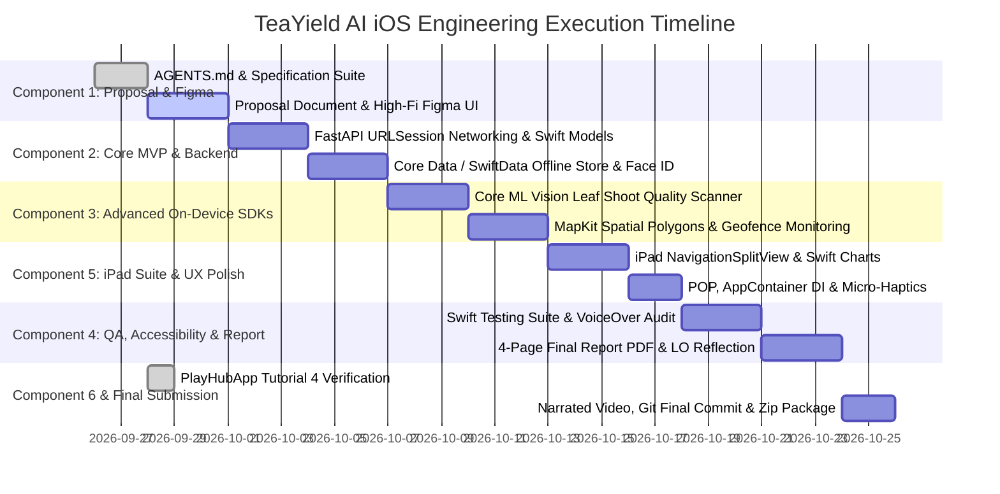

# Master Engineering Workflow & Delivery Roadmap
**Project Title:** TeaYield AI — Precision Tea Yield Prediction & Plucking Schedule Optimization Platform  
**Coursework:** NIBM BSc (Hons) Computing — iOS Application Development (BSCCOMP25.1P)  
**Target Grade:** 100% / A+ Distinction  
**Author:** Bhanuka Bandara (Student ID: 082 | Coventry ID: 16604375)  
**Institution:** National Institute of Business Management (NIBM) / Coventry University  
**Cross-Repo Reference:** `~/BSC-computing/research/teayield-ai-core` (Backend Core)

---

## 1. Dual-Track Ecosystem Execution Status

The TeaYield AI ecosystem operates on an Agile API-First dual-track strategy. The backend core (`teayield-ai-core`) has completed its database provisioning and API contract deployment, unblocking the native iOS companion application (`teayield-ai-ios`):

```
+───────────────────────────────────────────────────────────────────────────────────────────────────+
|                                    ECOSYSTEM WORKFLOW STATUS                                      |
+───────────────────────────────────────────────────────────────────────────────────────────────────+
| teayield-ai-core (Backend & Research):                                                            |
| • Phase 1: Specifications & Governance (Specs 01-08)                 [ COMPLETED ]                 |
| • Phase 2: Supabase PostgreSQL 15 & PostGIS Spatial Layer            [ COMPLETED ]                 |
| • Phase 3: FastAPI REST Service & Deterministic Stubs (31 tests pass) [ COMPLETED ]                 |
|                                                                                                   |
| teayield-ai-ios (Client & iOS Coursework):                                                        |
| • Component 1: Proposal, HIG Design System & Figma Prototype (10%)    [ IN PROGRESS / APPROVED ]    |
| • Component 2: MVP Core Implementation, Offline & Viva (20%)          [ READY TO EXECUTE ]          |
| • Component 3: Advanced iOS SDK - On-Device Vision & Geofence (20%)   [ READY TO EXECUTE ]          |
| • Component 4: Swift Testing, VoiceOver & 4-Page Report (15%)         [ PENDING ]                   |
| • Component 5: Above & Beyond - iPad SplitView & Architecture (25%)   [ PENDING ]                   |
| • Component 6: In-Class Tutorial 4 - PlayHubApp (10%)                 [ COMPLETED / READY ]         |
+───────────────────────────────────────────────────────────────────────────────────────────────────+
```

---

## 2. Multi-Phase Execution Timeline & Roadmap



---

## 3. Component Breakdown & Definition of Done (DoD)

### Component 1: Proposal & High-Fidelity UI/UX Prototype (10% - Mandatory)
- [x] Finalize TeaYield AI problem statement, target profiles (Managers vs Supervisors), and Zero-IoT USP.
- [x] Formulate HIG-compliant Design System tokens (Emerald `#059669`, Amber `#D97706`, Crimson `#DC2626`).
- [x] Design 10-screen High-Fidelity Figma Prototype covering both iPhone supervisor flow and iPad manager suite.
- [ ] Submit Component 1 proposal document & interactive Figma link via LMS for lecturer approval.
- **Definition of Done (DoD):** Proposal approved by module lecturer; Figma link verified and interactive.

### Component 2: MVP Core Implementation, External API & Live Viva (20% - Mandatory)
- [ ] Setup Xcode Project with strict MVVM folder structure (`Models`, `Views`, `ViewModels`, `Services`, `Repositories`).
- [ ] Implement `CloudAPIService` communicating with `teayield-ai-core` FastAPI backend via `URLSession`.
- [ ] Decode Pydantic DTOs into Swift `Codable` models (`FieldResponseDTO`, `DailySupervisorTasksResponseDTO`, `HarvestSyncBatchDTO`).
- [ ] Implement local SQLite persistence via Core Data / SwiftData (`TeaFieldEntity`, `NDVILogEntity`, `PluckingSessionEntity`).
- [ ] Implement Face ID / Touch ID authentication via `LocalAuthentication` securing executive rosters.
- [ ] Prepare live Viva presentation defense notes.
- **Definition of Done (DoD):** Functional app compiling cleanly in Xcode; loads fields from backend; authenticates via Face ID; persists weighing logs offline; passes live viva defense.

### Component 3: Advanced iOS SDK Integration - On-Device (20% - Mandatory)
- [ ] Feature 1 (Edge AI): Integrate on-device Core ML + Vision framework (`VNCoreMLModel`) running at 60fps on Apple Silicon Neural Engine to classify fine vs coarse leaf ratio ("Two Leaves and a Bud").
- [ ] Feature 2 (Spatial GIS): Implement MapKit spatial vector field polygon overlays (`MKPolygon`) and low-power background geofencing alerts (`CLCircularRegion`).
- [ ] Strict Compliance Verification: Confirm 0 remote cloud AI API calls and verify non-reuse of Component 2 features.
- **Definition of Done (DoD):** Camera viewfinder segmentation operates completely offline; background geofence dispatches arrival notifications upon entering field coordinates.

### Component 4: Swift Testing, Accessibility & Documentation (15%)
- [ ] Write unit test suite using Apple's modern **Swift Testing framework** (`import Testing`, `@Test`, `#expect`), achieving comprehensive coverage across ViewModels and repositories.
- [ ] Implement 100% VoiceOver support (`.accessibilityLabel`, `.accessibilityHint`) and Dynamic Type font scaling.
- [ ] Compile 4-Page Final Report PDF including **Learning Outcomes Reflection (LO1–LO4)** and non-code LLM log.
- **Definition of Done (DoD):** All Swift Testing suites pass green; VoiceOver navigates smoothly without unlabelled elements; 4-page PDF report conforms to anti-AI humanization guidelines.

### Component 5: Above & Beyond - Multi-Device iPad Suite & Architecture (25% - Maximum Weightage)
- [ ] Implement responsive multi-device design: iPhone compact supervisor view vs iPad desktop-class `NavigationSplitView` executive manager suite.
- [ ] Integrate Apple **Charts Framework** (`BarMark`, `LineMark`) for predicted yield visualizations and factory capacity gauges.
- [ ] Refactor application services using Protocol-Oriented Programming (POP) and Dependency Injection (`AppContainer`).
- [ ] Add SwiftUI custom matched geometry animations, micro-haptics (`UIImpactFeedbackGenerator`), and offline status banners.
- **Definition of Done (DoD):** Dynamic size-class adaptation between iPhone and iPad; zero tight coupling; fluid 60fps animations.

### Component 6: In-Class Tutorial 4 "PlayHubApp" (10%)
- [x] Refactor Tutorials 1-3 game modes (Tap Frenzy, Light It Up, Quiz Rush) into unified **PlayHubApp**.
- [x] TabBar navigation (Home, Stats, Map, Settings), Swift Charts (`BarMark`), MapKit pins, local notifications, `UserDefaults` persistence.
- [x] Lab check completed and Git commit history verified.
- **Definition of Done (DoD):** Complete Xcode project package verified.

---

## 4. Enterprise Git Flow, Branching Strategy & Release Protocol

TeaYield AI adheres to a rigorous **Phase-Aligned Git Flow Branching Protocol** matching enterprise software engineering standards and ensuring auditable academic progression across the semester.

### 4.1 Core Branching Architecture

```
+───────────────────────────────────────────────────────────────────────────────────────────────────+
|                                    GIT FLOW BRANCHING TOPOLOGY                                    |
+───────────────────────────────────────────────────────────────────────────────────────────────────+

  main (Protected / Production Stable / Viva Releases)
  ──────────────────────●────────────────────────────────────────●───────────────────────● (v1.2.0)
                        ▲ (v1.0.0-mobile-app)                    ▲ (v1.1.0-ai-client)    ▲
                        │ Merge Release Tag                      │ Merge Release Tag     │
  release/v1.0.0        │                                        │                       │
  ──────────────────────● (Cut release candidate)                │                       │
                        ▲                                        │                       │
  develop (Active Integration / Staging)                         │                       │
  ────●─────────●───────┴────────────────────────●───────────────┴───────────────────────┴──────────>
      │         ▲                                ▲
      │ Fork    │ PR Squash Merge                │ PR Squash Merge
      ▼         │                                │
  feat/comp-2-mvp-fastapi                        │
  ──────────────●                                │
                                                 │
  feat/comp-3-ondevice-coreml-vision ────────────●
                                                 
  hotfix/v1.0.1-geofence-fix (Emergency Hotfix Branch)
  ──────────────────────────────────────● (Branches from main, back-merges to main and develop)
```

### 4.2 Coursework Component-to-Branch Mapping

To prevent branch fragmentation, development follows a clean, single-branch-per-component milestone strategy:

| Component | Target Branch Name | Deliverable & Functional Scope | Base Branch | Target Branch |
| :--- | :--- | :--- | :--- | :--- |
| **Component 1** | `feat/comp-1-proposal-figma` | App proposal document, HIG design tokens, and 10-screen interactive Figma prototype. | `main` | `develop` |
| **Component 2** | `feat/comp-2-mvp-core` | Complete MVP: `URLSession` networking, FastAPI DTOs, Core Data offline caching, and Face ID auth. | `develop` | `develop` |
| **Component 3** | `feat/comp-3-advanced-sdk` | On-device Core ML Vision 60fps leaf scanner and MapKit spatial vector polygons with geofencing. | `develop` | `develop` |
| **Component 4** | `feat/comp-4-qa-a11y-report` | Apple Swift Testing suites (`@Test`, `#expect`), 100% VoiceOver accessibility audit, and 4-page final report PDF. | `develop` | `develop` |
| **Component 5** | `feat/comp-5-ipad-suite` | Desktop-class 3-column `NavigationSplitView`, Swift Charts yield analytics, `AppContainer` DI, and micro-haptics. | `develop` | `develop` |

> *Note on Component 6:* In-Class Tutorial 4 (PlayHubApp) is a standalone laboratory coursework project submitted and evaluated via its own dedicated repository. It is excluded from the TeaYield AI branch matrix.

### 4.3 Conventional Commits 1.0.0 Formatting

All commits must follow the Conventional Commits specification:
```
<type>(<scope>): <short imperative subject summary>

<detailed body paragraph explaining rationale and technical decisions>
```

- **Types:** `feat`, `fix`, `docs`, `style`, `refactor`, `perf`, `test`, `chore`
- **Permitted Scopes:** `comp1`–`comp5`, `coredata`, `networking`, `vision`, `mapkit`, `charts`, `auth`, `a11y`
- **Rules:** Imperative mood ("Add ...", not "Added ..."), max 72 character subject, strict exclusion of emojis.

### 4.4 Pull Request Quality Gate & Definition of Done Checklist

Before any feature branch merges into `develop`:
- [x] Clean Xcode build with 0 compiler warnings and 0 errors.
- [x] Swift Testing suites pass with 100% green status (`import Testing`, `#expect`).
- [x] All UI-bound ViewModels annotated with `@MainActor` to eliminate data races.
- [x] Core Data saves execute on background contexts (`newBackgroundContext`).
- [x] 100% VoiceOver accessibility labels and Dynamic Type font scaling applied.
- [x] Swift `Codable` models conform to FastAPI backend Pydantic v2 schemas.
- [x] Strictly zero emojis across source code, comments, docstrings, and commits.
- [x] Confidential `.agents/` folder strictly gitignored.

### 4.5 Dual-Repository Version Synchronization

| Core Backend Tag (`teayield-ai-core`) | iOS Client Tag (`teayield-ai-ios`) | Integrated Milestone Scope |
| :--- | :--- | :--- |
| `v0.1.0-specs` | `v0.1.0-specs` | Full specifications and architecture finalized across both repos. |
| `v0.2.0-gateway` | `v0.2.0-client-stubs` | FastAPI microservice live with deterministic stubs; iOS networking ready. |
| `v0.3.0-mobile-release` | `v1.0.0-mobile-app` | Native iOS app demonstrable with Core Data, Face ID, Vision, and MapKit. |
| `v0.5.0-ai-integrated` | `v1.1.0-ai-client` | Live LSTM yield prediction and Genetic Algorithm roster sync operational. |
| `v1.0.0-final` | `v1.2.0-final` | Final production build, 4-page report compiled, ready for viva defense. |

> Detailed protocol, branch protection rules, and CI/CD pipeline blueprint available in [GIT_BRANCHING_STRATEGY.md](../teayield_ai_specs/GIT_BRANCHING_STRATEGY.md).
